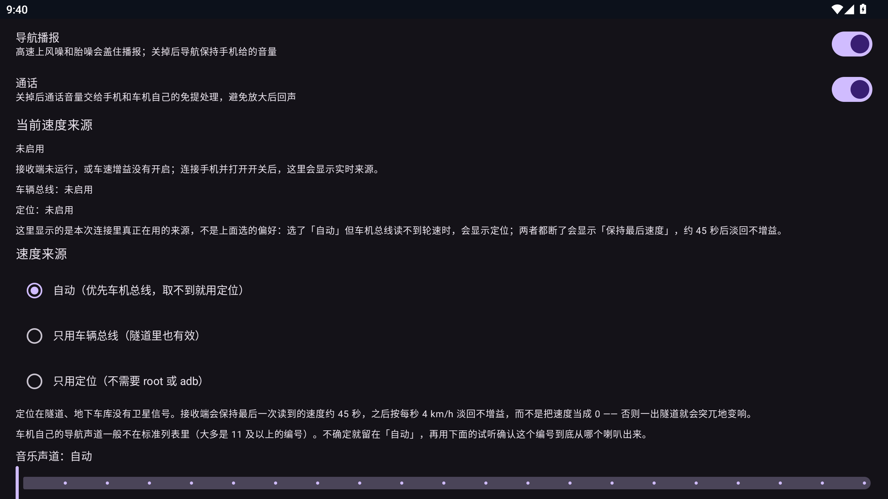

# HiCar receiver for Android head units

DiPlay is now a **HiCar receiver**: it makes an Android head unit that shipped without HiCar behave
as the car side of a Huawei HiCar session. The CarPlay, AirPlay and iAP2 stacks, the HUD and cluster
outputs and the CarPlay home screen have been removed; what remains is the receiver, its settings and
the diagnostics needed to bring one up on a head unit nobody has tested before.

Package `com.shihab.diplay` · Android 7.0+ (API 24) · GPL-3.0 · [简体中文](README.zh-CN.md) ·
[繁體中文](README.zh-TW.md)



## Status

This is an experimental receiver, and the README says which parts have evidence behind them.

- **Wireless works on the development car.** On a BYD Song Plus (Android 10) with a Mate 80 Pro Max:
  the phone shows the HiCar prompt, the six-digit code is accepted, the picture appears, sound plays,
  taps/slides/back/home work, and a phone that was paired once reconnects without the code. The log of
  that run is in [docs/HICAR_MIGRATION.md](docs/HICAR_MIGRATION.md) §7.49.
- **Everything newer has run in tests, not on a car.** Multi-touch, the picture tiers, the split audio
  lanes and channel choice, QR pairing, lazy hotspot creation, redialling from the car, restoring the
  car's own Wi-Fi, the speed-linked gain (music, guidance and calls) and the wired NCM path are
  compiled and unit-tested. The About section of the settings page says which parts have not been
  tested on a car.
- **Wired HiCar is unverified end to end.** No cable session with a phone has completed; see
  [docs/HICAR_WIRED.md](docs/HICAR_WIRED.md).
- **HUD and instrument-cluster output are not implemented.** They were CarPlay features and were
  removed with that stack.

## What it does

### Connection

1. The head unit advertises the HiCar service (`0xFDEE` over BLE) and shows a six-digit connection code.
2. The phone finds the car, prompts, and the driver enters the code.
3. RFCOMM `0xFE35` carries HiChain. The car proves itself with the code — no Huawei-issued accessory
   certificate and no account server.
4. After authentication the car opens a 5 GHz access point; the phone joins it and control moves to
   TCP `4005`/`4006`/`4007`.
5. Video arrives over HiSight/RTSP as H.264, is decoded and drawn into a `TextureView`; touches and
   keys go back over a UIBC channel encrypted with AES-128-CTR.

A QR code on the setup page carries the car's Bluetooth address, model id and code, so a phone can
scan instead of typing; the address is refused rather than drawn when it is a placeholder.

### While connected

- **Display modes**: full screen, status bar, or status bar and navigation bar. The picture is fitted
  to the space that is left — never stretched — and the mode can be changed without dropping the
  session.
- **Settings without disconnecting**: the settings page is drawn *over* the session, in the same
  activity, because a second activity would pause the surface and black out the picture.
- **Steering-wheel and media keys** are forwarded to the phone (play/pause, previous, next, and the
  rest of the standard media keys) when the phone says it accepts them; switched off, they stay with
  the car.
- **Multi-touch**: a touch packet carries every finger in a snapshot, so pinch and two-finger gestures
  work in the phone's map.
- **Picture quality**: three sharpness steps and a frame rate that follows the panel or is pinned to
  30/60 fps. Answered once per connection, and the page says so.
- **Audio by purpose**: music, guidance, prompts, calls and ringtones each get their own decoder,
  queue and `AudioTrack`, so a guidance prompt can play on the unit's own navigation channel while
  music keeps its own. Each channel can be pinned to a legacy stream number (0 = automatic) and
  previewed with a short tone.
- **Speed-linked gain**: music, guidance and calls can each follow a speed curve (start speed, full
  speed, ceiling in dB), applied to the PCM samples inside the receiver — no system volume is touched.
  The settings page shows **which source is answering right now** — car bus, location, held through a
  loss of signal, or none — together with the current speed and gain. Guidance and calls have their
  own switches.
- **Second launcher icon**: "HiCar 设置" opens the same activity with the settings page already up, so
  a setting can be changed during a session without hunting for the small entry on the picture.

### Housekeeping

- The access point opens only after a phone authenticates, so a receiver with no phone does not take
  the car's Wi-Fi for nothing.
- A phone whose Bluetooth link comes up can be redialled from the car, which is the only answer to a
  handset that does not dial on its own.
- The car's own Wi-Fi is asked back when the receiver stops.
- An optional accessibility service presses "允许" on the system's USB permission dialog; it matches
  only a window that mentions USB and has a confirming button.
- **Wired HiCar** is driven from user space (CDC-NCM interface, NTB16 framing, ARP replies, a
  `VpnService` TUN and two transport threads) because this head unit's kernel has no `rndis_host`.
  Off by default; unverified.

## Requirements

| | |
| --- | --- |
| Head unit | Android 7.0+ (API 24), APK installation allowed, Bluetooth 4.0+ with BLE advertising, Wi-Fi able to run a 5 GHz access point |
| Phone | Huawei phone with HiCar. The development phone is a Mate 80 Pro Max |
| Speed by car bus | The manufacturer's wheel-speed channel. On BYD this is `autoservice`, reached over adb or root; without it the feature uses location |
| Speed by location | Fine-location permission, and a view of the sky. Tunnels hold the last speed for about 45 s, then fade |

## Install

Install on the **car**, not the phone. The debug build has the suffix `.hudtest`
(`com.shihab.diplay.hudtest`) and can sit next to a release install; both use the same preferences
names but separate app data.

1. Copy the APK to the head unit and install it (a file manager, or `adb install`).
2. Open **HiCar**, allow the permissions it asks for (Bluetooth advertise/connect, Wi-Fi, location).
3. Pair the phone with the head unit once in the system Bluetooth settings — the reference receiver
   requires this, and a first connection is much more reliable after it.
4. Press **开始** and enter the six-digit code on the phone, or scan the QR code.

If a connection fails, the screen and the exported log say where it stopped. Export from
**设置 → 诊断 → 导出日志**; the report is written to `Downloads/DiPlay` on Android 10+ and includes the
connection code on purpose (a rejected code is itself the failure being investigated).

## Build

```bash
export JAVA_HOME=/path/to/jdk-21-or-newer   # the build uses a modern JDK
./gradlew :shared:testDebugUnitTest :common:compileDebugKotlin :mobile:assembleDebug
```

`mobile` is the APK; `samples/*` are unrelated demo apps. The debug APK is
`mobile/build/outputs/apk/debug/mobile-debug-unsigned.apk` — sign it with your own key before
installing. A release build needs `DIPLAY_AUTH_ASSETS_DIR` only for the legacy CarPlay identity, which
this receiver does not use.

`automotive` and the map samples are leftovers of the CarPlay era and are not part of the receiver.

## Documentation

- [Interface, display modes and the two launcher entries](docs/HICAR_UI.md)
- [Protocol reconnaissance and what the head unit can and cannot do](docs/HICAR_RECON.md)
- [Migration log: every real attempt, with the log lines](docs/HICAR_MIGRATION.md)
- [Steering-wheel keys](docs/HICAR_KEYS.md) · [Wired HiCar](docs/HICAR_WIRED.md) · [ADB checklist for a head unit](docs/HICAR_ADB.md)
- [What was taken from OpenHC, and what was deliberately not](docs/OPENHC_COMPARISON.md)
- [CarPlay removal: the boundary and the progress](docs/CARPLAY_REMOVAL.md)
- [Release notes](CHANGELOG.md) · [Third-party notices](docs/THIRD_PARTY_NOTICES.md)

## Source and credits

Based on [xcertplay](https://github.com/shilapi/xcertplay), GPL-3.0. The receiver ports work from
[huducat586/hicar-android-receiver](https://github.com/huducat586/hicar-android-receiver) (MIT) and
[GGBondLab/OpenHC](https://github.com/GGBondLab/OpenHC) (GPL-3.0-only): the media-key forwarding, the
multi-touch snapshot, the picture tiers, the audio lane split, the QR pairing format, user-space NCM
and the redial direction. HiChain comes from OpenHarmony's `deviceauth_lite` and `huks_lite`
(Apache-2.0), built into `libhicarauth.so`. Preserve those notices when distributing a modified
version.

HiCar is a Huawei product; this project is not affiliated with or endorsed by Huawei or BYD. Use it
only where you are allowed to install software on the vehicle you own.
