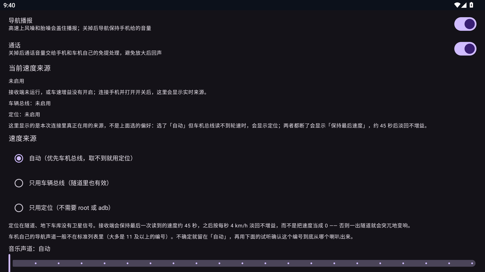

# Android 車機上的 HiCar 接收端

DiPlay 現在是一個 **HiCar 接收端**：讓一台沒有前裝 HiCar 的 Android 車機，扮演華為 HiCar 工作階段裡
「車」的那一側。CarPlay / AirPlay / iAP2 通訊協定堆疊、HUD 與儀表板輸出、CarPlay 首頁都已從程式碼
刪除，剩下的是接收端本體、它的設定頁，以及在一台沒人試過的車機上把鏈路拉起來所需的診斷。

套件名稱 `com.shihab.diplay` · Android 7.0+（API 24）· GPL-3.0 · [English](README.md) ·
[简体中文](README.zh-CN.md)



## 現況

這是實驗性的接收端，以下把「有證據的」和「只在測試裡跑過的」分開寫。

- **無線鏈路已在開發車上跑通。** 比亞迪宋 Plus（Android 10）+ Mate 80 Pro Max：手機跳出 HiCar
  提示、六位數連線碼被接受、有畫面、有聲音、點按/滑動/返回/主頁可用、配對過一次後免碼回連。那次
  的日誌在 [docs/HICAR_MIGRATION.md](docs/HICAR_MIGRATION.md) §7.49。
- **之後新增的功能只在編譯和單元測試裡跑過，還沒有上車。** 多指觸控、清晰度/影格率檔位、音訊依用途
  分路與聲道選擇、掃碼配對、熱點延後開啟、車機主動回連、還原車機自己的 Wi-Fi、隨車速增益（音樂/
  導航/通話）、有線 NCM 通路，都是「編譯通過 + 單元測試涵蓋」。哪些還沒上車，設定頁的「關於」一節
  寫明了。
- **有線 HiCar 沒有端對端驗證。** 還沒有一次與手機的完整有線工作階段，見
  [docs/HICAR_WIRED.md](docs/HICAR_WIRED.md)。
- **HUD 與儀表板輸出沒有實作。** 它們屬於 CarPlay 時期的功能，隨那套程式碼一起刪除了。

## 它能做什麼

### 連線

1. 車機在 BLE 上廣播 HiCar 服務（`0xFDEE`），螢幕顯示六位數連線碼。
2. 手機發現車機並跳出提示，駕駛在手機上輸入連線碼。
3. RFCOMM `0xFE35` 上跑 HiChain。車機用連線碼證明自己 —— 不需要華為簽發的配件憑證，也不需要
   任何帳號伺服器。
4. 驗證通過後車機開 5 GHz 熱點，手機接入，控制通道轉到 TCP `4005`/`4006`/`4007`。
5. 畫面走 HiSight/RTSP，H.264 解碼後畫進 `TextureView`；觸控與按鍵走一條 AES-128-CTR 加密的
   UIBC 通道回傳。

連線頁上還有一個 QR code，帶車機的藍牙位址、機型碼和連線碼，手機掃碼即可，不必手輸；位址還是
預留值時只顯示一句原因，不畫一個「掃了也連不上」的碼。

### 連線中

- **顯示方式**：全螢幕、狀態列、狀態列+導覽列。畫面依手機的解析度等比縮放到剩下的空間，永不拉伸；
  切換模式不需要中斷連線。
- **連線中改設定**：設定頁是**疊在**工作階段畫面上的一層，和接收端在同一個 Activity 裡。第二個
  Activity 會讓畫面所在的 surface 暫停，鏡像就黑了 —— 這是它不做成獨立頁面的原因。
- **方向盤與媒體鍵**轉給手機（播放/暫停、上一首、下一首及其餘標準媒體鍵）：手機在能力回應裡聲明
  接受時才轉送；關掉開關，按鍵立刻歸車機。
- **多指觸控**：一個觸控封包攜帶全部手指的快照，手機地圖上的雙指縮放可用。
- **畫面品質**：三檔清晰度，影格率可跟隨螢幕或固定 30/60。這兩項在連線建立時一次性回覆手機，變更
  從下次連線生效，設定頁寫明了這點。
- **依用途分路的聲音**：音樂、導航、提示音、通話、鈴聲各自有解碼器、佇列和 `AudioTrack`，導航
  播報可以走車機自己的導航聲道，音樂仍留在音樂聲道。每條通道可以釘到一個舊式 stream number
  （0 = 自動），並用一段短音試聽。
- **隨車速增益**：音樂、導航、通話可以各自跟隨同一條速度曲線（起始速度、滿檔速度、上限 dB），增益
  直接乘在接收端解出來的 PCM 取樣上，不動車機和手機的系統音量。設定頁會顯示**目前真正在用的
  來源** —— 車輛匯流排、定位、訊號中斷時的保持、或沒有 —— 以及目前速度和增益。導航與通話各有
  獨立開關。
- **桌面上第二個入口**：「HiCar 设置」圖示開啟同一個 Activity 並直接展開設定頁，連線中想改設定
  不必在畫面上找那個小入口。

### 收尾

- 熱點在手機驗證通過之後才開：車裡沒有手機時，接收端不會白佔車機的 Wi-Fi。
- 已知手機的藍牙鏈路一上來，車機可以主動回撥它 —— 這是對「手機自己不會撥」的唯一答案。
- 停止接收端時，會把車機自己的 Wi-Fi 要回來。
- 可選的無障礙服務替使用者按系統 USB 授權視窗上的「允許」；它只認同時提到 USB 且有確認按鈕的視窗。
- **有線 HiCar** 在使用者空間實作（CDC-NCM 介面、NTB16 組框、自答 ARP、`VpnService` TUN、兩條傳輸
  執行緒），因為這台車機的核心沒有 `rndis_host`。預設關閉，未驗證。

## 環境需求

| | |
| --- | --- |
| 車機 | Android 7.0+（API 24），允許安裝 APK，藍牙 4.0+ 且能發 BLE 廣播，Wi-Fi 能開 5 GHz 熱點 |
| 手機 | 支援 HiCar 的華為手機。開發機是 Mate 80 Pro Max |
| 車速（車輛匯流排） | 廠商自己的輪速通道。比亞迪上是 `autoservice`，需要 adb 或 root；取不到就用定位 |
| 車速（定位） | 精確定位權限，且能看見天空。隧道裡保持最後速度約 45 秒，然後淡回不增益 |

## 安裝

裝在**車機**上，不是手機。debug 套件帶後綴 `.hudtest`（`com.shihab.diplay.hudtest`），可以和正式版
並存；兩者偏好設定檔名相同，但資料目錄各自獨立。

1. 把 APK 拷到車機並安裝（檔案管理器或 `adb install`）。
2. 開啟 **HiCar**，同意它申請的權限（藍牙廣播/連線、Wi-Fi、定位）。
3. 先在車機和手機的「系統藍牙設定」裡完成一次一般配對 —— 參考接收端要求這一步，配過之後再連
   成功率高得多。
4. 點 **开始**，在手機上輸入六位數連線碼，或掃 QR code。

連線失敗時，螢幕和匯出的日誌會說明停在哪一步。從 **設定 → 診斷 → 匯出日誌** 匯出；Android 10+
寫到 `Downloads/DiPlay`。報告裡故意包含連線碼（「碼被拒」本身就是被排查的失敗）。

## 建置

```bash
export JAVA_HOME=/path/to/jdk-21-or-newer
./gradlew :shared:testDebugUnitTest :common:compileDebugKotlin :mobile:assembleDebug
```

`mobile` 是 APK，`samples/*` 是無關的示範應用。debug 套件在
`mobile/build/outputs/apk/debug/mobile-debug-unsigned.apk`，裝之前用你自己的金鑰簽章。release
建置只有舊的 CarPlay 身分需要 `DIPLAY_AUTH_ASSETS_DIR`，這個接收端不用它。

`automotive` 與地圖範例是 CarPlay 時期的遺留，不屬於接收端。

## 文件

- [介面、顯示模式與桌面上的兩個入口](docs/HICAR_UI.md)
- [通訊協定偵察與車機能力邊界](docs/HICAR_RECON.md)
- [遷移日誌：每一次真實嘗試，附日誌行](docs/HICAR_MIGRATION.md)
- [方向盤按鍵](docs/HICAR_KEYS.md) · [有線 HiCar](docs/HICAR_WIRED.md) · [車機 adb 判定清單](docs/HICAR_ADB.md)
- [從 OpenHC 借鏡了什麼、明確不做什麼](docs/OPENHC_COMPARISON.md)
- [CarPlay 刪除：邊界與進度](docs/CARPLAY_REMOVAL.md)
- [變更日誌](CHANGELOG.md) · [第三方聲明](docs/THIRD_PARTY_NOTICES.md)

## 來源與授權

基於 [xcertplay](https://github.com/shilapi/xcertplay)，GPL-3.0。接收端移植了
[huducat586/hicar-android-receiver](https://github.com/huducat586/hicar-android-receiver)（MIT）與
[GGBondLab/OpenHC](https://github.com/GGBondLab/OpenHC)（GPL-3.0-only）的做法：媒體鍵轉送、多指
觸控快照、畫面檔位、音訊分路、QR code 配對格式、使用者空間 NCM 與主動回連方向。HiChain 來自
OpenHarmony 的 `deviceauth_lite` 與 `huks_lite`（Apache-2.0），編進 `libhicarauth.so`。散布修改版
時請保留這些聲明。

HiCar 是華為的產品；本專案與華為、比亞迪沒有隸屬或背書關係。只在你擁有且允許安裝軟體的車輛上
使用。
